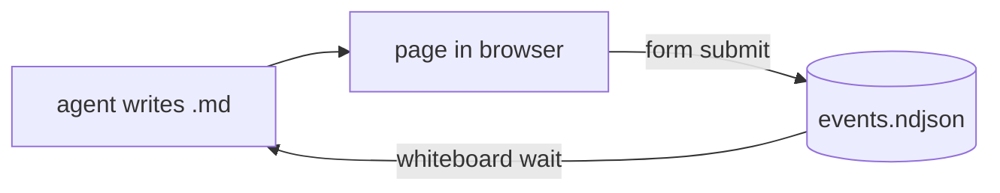

# mermaid

A [Mermaid](https://mermaid.js.org) diagram from a fence: flowcharts,
sequence, state, class, ER, gantt, pie and the other Mermaid types. Rendered
to SVG on the server by [Pele](https://pele.run), so no script runs on the
page; colours follow the page theme. A syntax error shows the line and
column in place of the diagram.

````markdown

````


