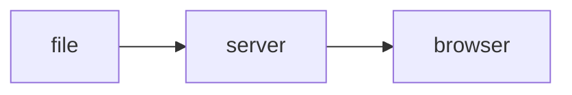

Windows: a header with a label, a button that fills the browser window with
what it shows (the same button, or Esc, puts it back), and one that opens it on
its own. `bare` leaves the header out; `wide` makes it wider than the text
column; `height` (pixels or a CSS length) fixes its height, scrolling inside.

**One image or video**, its label the title, ↗ opening the file:

```markdown
::image[The new onboarding]{src="onboarding.png"}

::video[The bug, recorded]{src="bug.mp4" loop muted poster="bug.png"}
```

A video has its controls; `loop`, `autoplay` (which starts it muted, as
browsers require) and `poster` are as for a `<video>`. A plain markdown image,
``, stays an image without a window.

**Any markdown**, in `:::window`: a diagram, a table, a screenshot with words
under it. When it holds one image or video, ↗ opens that file.

````markdown
:::window[How a page is served]{wide}

:::
````

An iframe (`::iframe`) is a window around another page.
