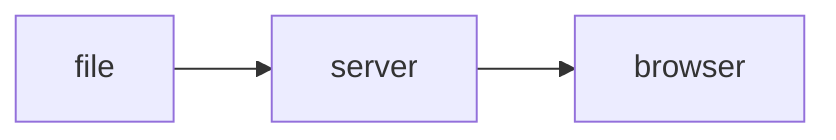

A window: a header with a label, a button that fills the browser window with
what it shows (the same button, or Esc, puts it back), and one that opens it on
its own.

**Any block goes in one with `compose=window`**: an image, a video, another
page, a diagram, a grid. Its label is the window's title (or `title="A
title"`, for a block without a label, such as a fence), and ↗ opens what it
shows on its own, an image's file or a page's address. `wide` makes it wider
than the text column.

````markdown
::image[The new onboarding]{src="onboarding.png" compose=window}



:::grid{cols=2 compose=window title="Two options"}
…
:::
````

**One image or video**, without it, is just itself:

```markdown
::image[The new onboarding]{src="onboarding.png"}

::video[The bug, recorded]{src="bug.mp4" loop muted poster="bug.png"}
```

A video has its controls; `loop`, `autoplay` (which starts it muted, as
browsers require) and `poster` are as for a `<video>`. A plain markdown image,
``, is the same as `::image` without it.

**Any markdown**, in `:::window`: a table, a screenshot with words under it,
what has no block of its own. When it holds one image or video, ↗ opens that
file. `height` (pixels or a CSS length) fixes its height, scrolling inside.

```markdown
:::window[What each one takes]
| block | what |
| --- | --- |
| `::image` | one image |
:::
```

`compose=window` is this plugin's `compose`: any plugin can compose itself
around blocks the same way, and a block names several in order:
`compose=window,badge`.
